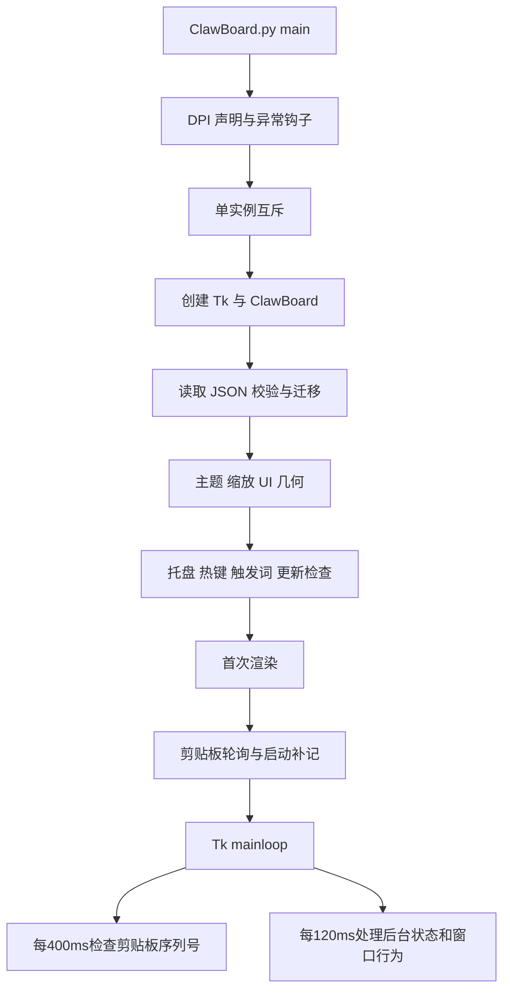
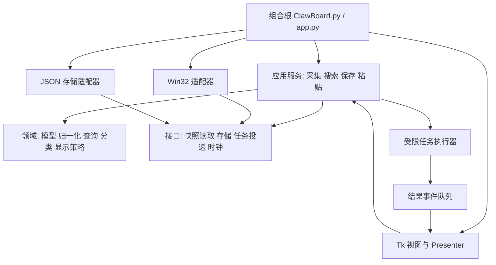
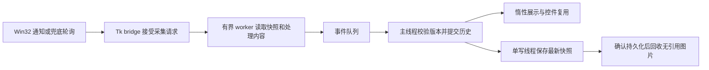

# ClawBoard 项目解析、性能诊断与重构设计

本报告的代码基线是 `pay-and-gain/ClawBoard` 主分支提交 `6a10466e51418baabff617982c913c0480084a52`，读取时间为 2026-10-23。当前发行版为 **v2.6.1**，发布于 2026-10-14。分析同时参考代码、最近提交、发行说明、项目截图与隔离诊断，并对固定上游快照和重构审阅分支进行对照。上游快照不会随本次重构变化，文中的上游行号均指向该固定提交。

阅读范围：前文“项目结构”至“优化顺序”分析的是上游基线，其中的问题描述不等于重构后的现状。文末“本次实施与验证结果”列出实际完成的改动、前后测量与尚未验证的部分；新的维护入口为 `docs/REFACTOR.md`。本轮保留 tkinter、零运行时第三方依赖、JSON 数据兼容和 v2.6.1 版本号，未发布新版本。

项目已经具备日常剪贴板工具需要的大部分能力：文本、图片和文件路径记录，常用语、搜索、快速粘贴、隐私过滤、托盘、热键、主题、缩放、更新提示与便携数据。现阶段最值得投入的是**缩短界面主线程上的工作、明确数据与 UI 的边界、加强跨版本保存可靠性**。继续叠加功能会放大现有耦合；只改变颜色和圆角也不足以改善卡顿。

**项目结构与技术栈**

| 部分 | 主要文件 | 实际职责 |
|---|---|---|
| 入口与兼容层 | `ClawBoard.py` | DPI、异常日志、单实例、`Tk` 根窗口、主循环；重导出旧版公共符号；提供 `--bench`、`--shot`；把旧式 `C.NO_SAVE = True` 桥接到运行时状态 |
| 应用组合根 | `clawboard/app.py` | 创建 `ClawBoard`，初始化状态与数据，装配界面、几何、热键、托盘、更新与轮询 |
| 配置与状态 | `config.py`、`runtime.py`、`theme.py` | 版本号、默认设置、数据路径、TypedDict 契约、AppState 默认值、共享运行状态与颜色推导 |
| 数据与系统编排 | `app_services.py` | 数据读取、校验、迁移、保存、入库、来源补抓、更新、触发词、后台事件、剪贴板处理；当前同时承担过多职责 |
| 界面编排 | `app_ui.py` | 标题栏、标签、工具条、搜索、空状态；把原始条目转换成列表展示数据 |
| 交互与粘贴 | `app_interact.py` | 单击、多选、键盘选择、收藏与固定、常用语编辑、粘贴、预览、删除与导出入口 |
| 窗口行为 | `app_geometry.py` | DPI 与缩放、拖动拉伸、跨屏定位、折叠、靠边隐藏、置顶状态、圆角与 Acrylic |
| 通用 UI | `widgets.py`、`vlist.py`、`dialogs.py` | 通用弹窗、提示与预览、细滚动条、固定行高虚拟列表、设置/变换/导出界面 |
| 内容领域逻辑 | `classify.py`、`timefmt.py`、`tag.py`、`pinyin.py`、`trigger.py` | 类型与代码识别、时间与迁移、标签、拼音转换、触发词匹配 |
| 查询与变换 | `query.py`、`transform.py` | 查询语法解析和谓词过滤；27 项文本变换 |
| Windows 接口 | `win32.py`、`clipboard.py`、`hotkey.py`、`image.py` | ctypes 声明、焦点与发键、剪贴板读写及隐私标记、热键和托盘消息窗口、DIB↔PNG |
| 增量功能 | `onboard.py`、`sound.py`、`update.py`、`command_palette.py` | 首次引导、异步音效、版本查询与命令面板 |
| C 实现 | `ClawBoardC/main.c`、`.vcxproj`、`build.bat` | 纯 Win32/GDI 实现，独立的数据结构、JSON 读写、查询、变换和窗口过程 |
| 交付与验证 | `packaging/`、`tests/`、`docs/` | PyInstaller、Inno Setup；回归与独立 QA 脚本；架构、需求、使用说明和截图 |

Python 产品运行时使用标准库 `tkinter`、`ctypes`、`json`、`re`、`threading`、`queue`、`zlib` 等，**没有 pip 运行时依赖**。打包阶段使用 PyInstaller，安装包使用 Inno Setup；C 版需要 MSVC 构建。标准库并不代表跨平台：`winreg`、`WinDLL` 和 Windows 桌面行为决定产品运行目标是 Windows 10/11。当前源码包内有 27 个 Python 模块，GitHub 树中 `tests/` 下有 41 个 Python 脚本，包含数据生成器；README 中的“16 个模块/16 个测试文件”已过时。

持久化采用 `ClawBoard数据.json`，图片正文放在 `images/`。脚本与可写目录中的 exe 采用便携布局；安装目录不可写时回退到 `%APPDATA%\ClawBoard`。Python 版使用 `schema_version=3`、迁移备份与临时文件替换，避免把半截 JSON 直接写成正式数据。C 版也使用同名文件，但其实际保存契约存在后述兼容缺陷。

**现有架构的优点与边界**

v1.5 起将早期大脚本拆入包，查询、变换、分类等纯函数已经可以独立测试；虚拟列表控制了屏幕上实际存在的控件数量；粘贴路径已经区分标准编辑控件和自绘应用；全屏置顶状态机区分用户意图、全屏抑制与临时让位。这些都值得保留。

目前主要复用机制仍是多重继承：`ClawBoard` 组合 `DataMixin`、`SystemMixin`、`UiMixin`、`GeometryMixin` 与 `InteractionMixin`，后者再继承常用语 mixin。各 mixin 通过同一个 `self` 读取数据、窗口、设置、选择与计时器，依赖没有显式列在接口上。因此一个方法既能改数据、又能保存、刷新列表、启动线程和弹提示。文件拆开了，运行时职责仍相互穿透。`DataMixin` 所在模块也导入 Tk、热键、Windows 接口和 UI 控件，数据层无法直接独立加载。某些文件还超出 AGENTS.md 的 800 行规则：基线 `win32.py` 1043 行、`dialogs.py` 804 行、`app_services.py` 801 行。

**关键程序流程**

启动期间先读取和归一化全库，再构建 UI。`setup_system()` 会等待隐藏消息窗口就绪，最长 3 秒；随后启动检查更新。网络查询已在后台执行，有 5 秒超时和自动检查频率闸，因此不应把普通搜索卡顿归因于更新请求。初始化完成前还会执行启动补记；如果剪贴板内有大图或长文本，其处理成本会进入首屏响应路径。

文本采集依次检查 Windows 官方私密标记、图片格式、文本与文件列表；内容过长时截断，再进行敏感识别、忽略名单和长度过滤。新条目生成 ID、时间、来源、大小、分类与标签；重复文本刷新次数和更新时间并移到列表前方；裁剪历史时豁免收藏项。最后安排延迟保存、刷新列表，并按设置显示提示或播放声音。来源抓取为空时有一次后台补抓。图片路径采用 DIB→PNG→图片文件→JSON 元数据，文件剪贴板则把 CF_HDROP 路径保存为文本，粘贴时再还原 CF_HDROP。

搜索路径为 `Entry KeyRelease → render() → visible_items() → Q.match()`，再排序、计算副标题、打码、徽章和展示字典，交给 `VirtualList.set_data()`。过滤条件包含普通词、多词 AND、排除、来源、时间、类型、大小、收藏/敏感/固定和标签。拼音由单字表及最长词组匹配纠正部分多音词，全拼与首字母都参与查询。基线虽然注释提到“倒排索引”，实际执行的是逐条谓词过滤，没有完整倒排索引。

粘贴时先把文本、文件或图片写回剪贴板，再根据目标控件选择 `WM_PASTE` 或后台焦点恢复加 `SendInput`。后者还包含修饰键释放、焦点等待与临时置顶让位；管理员权限目标可能拒绝焦点，需要给出手动 Ctrl+V 降级提示。剪贴板写入成功和目标程序真正接收内容是不同状态，反馈文案和声音应与能够确认的状态一致。

保存调用的 `later=True` 是 **300ms 防抖**，仍由 Tk `after` 在主线程执行整个 `json.dump()` 和文件替换；它减少保存次数，没有把磁盘与序列化工作移到后台。正确重构需要同时明确保存快照、写入顺序、退出刷新和错误反馈。

**最近提交与项目当前状态**

最近读取的 12 个主分支提交都集中在 2026-10-14，说明最近工作重心是可靠性和真实使用问题，而非新增业务模块。

| 提交 | 内容与含义 |
|---|---|
| `6a10466` | 回退截图中只因时间列变化产生的差异，避免非确定性图片噪声 |
| `43f6180` | 发布 v2.6.1，多屏面板移动修复 |
| `ef84102` | 补充几何边界说明与防御 |
| `07f543d` | 独立多屏 QA A–H，提交说明记录 81 项断言通过 |
| `d826819` | 角落预览跟随面板所在屏，更新架构方法名 |
| `507d691` | 修复跨屏移动被边界钳住的主因 |
| `711bed1` | 更新检查 QA 去除硬编码版本号，改核对安装脚本 |
| `21b3d67` | 发布 v2.6.0，启动补记与长文本正则性能修复 |
| `d844248` | 入库补记独立验证脚本 |
| `212b626` | 修复测试 NO_SAVE 时序竞态造成的偶发假失败 |
| `f5bff60` | 敏感/标签 email 正则增加预筛与长度上界 |
| `783db92` | 补记静默化，并保留长度过滤 |

查询时未发现未关闭的 Issues 和 PR；这仅表示 GitHub 没有登记中的任务，不能据此认定产品没有缺陷。可见 Actions 运行是 Pages 部署，最新一次成功；该成功状态不等于 Windows 产品构建与 GUI 回归成功。

文档应同步整理：`上下文快照.md` 仍描述 v1.5.x，`需求全景.md` 和 `PROGRESS.md` 以 v1.x 为主，仍列出后来已经完成的图片/文件、备份轮转、日志上限和固定条目建议。实际 `backup_data()` 已保留三份迁移备份，日志已在 512KB 左右触发尾部保留；这两项不应再作为“尚未实现”的优化。

**运行流畅度诊断与证据**

下面的数字来自 Linux、Python 3.12.14 云环境，使用合成数据执行上游真实纯函数；搜索与 JSON 取三次中位数，图片转换每个尺寸一次。没有创建 Windows App，也没有接触真实剪贴板或用户数据。数字用于定位算法和工作量，不能当作用户电脑帧率、Windows 启动速度或正式性能承诺。初始诊断的 `diagnostics-results.json` 和 `diagnostics.py` 仅随本地审阅交付包提供，不是仓库内可用文件；仓库中的最终对照数据与复现入口见文末。

| 场景 | 基线耗时 | 解释 |
|---|---:|---|
| 500 条，每条约 200 字符，`app:chrome` | 153.8ms | 仅结构字段查询也生成全文拼音 |
| 500 条，每条约 2000 字符，`app:chrome` | 1098.4ms | 一次输入即可占住事件循环约一秒 |
| 同一批 500×2000 数据，普通词 `hello` | 1062.2ms | 原文已直接命中，仍先生成拼音 |
| 5000 条，每条约 200 字符，`app:chrome` | 926.7ms | 总字符量比条目数量更能解释成本 |
| 1280×720 DIB→PNG | 798.7ms | Python 逐像素通道转换，加 zlib 压缩 |
| 1920×1080 DIB→PNG / PNG→DIB | 2892.8ms / 1165.2ms | 目前采集与图片粘贴调用链在 UI 线程发起转换 |
| 3840×2160 DIB→PNG / PNG→DIB | 4029.7ms / 2593.2ms | 大图容易造成可感知长停顿 |
| 5000×2000 字符，约 13.1MB JSON | 72.1ms | 仅序列化到内存，尚未计算真实磁盘延迟 |
| 500×20000 字符，约 12.6MB JSON | 47.9ms | 少量长文本同样会超过流畅交互预算 |

来源字段直接过滤的诊断参考实现，在 500×2000 场景约 0.03ms；它只用于说明可以完全避开全文拼音工作，并非完整新搜索引擎的实测结果。一次带 profiler 的同场景运行显示约 6.8 秒累计时间中约 6.8 秒落在两种拼音转换上；profiler 有显著额外开销，其绝对时间不与上表混用。

最优先的性能改动有五项：

1. **按需要生成搜索材料。** 先检查 type/app/tag/time 等廉价字段；没有普通词时不构造全文索引。正文或名称直接命中时避免生成拼音；剩余拼音结果做有界缓存，修改正文后失效。缓存应按条数和字符总量限额，避免长文本把内存换成另一个瓶颈。证据：[query.py:211](https://github.com/pay-and-gain/ClawBoard/blob/6a10466e51418baabff617982c913c0480084a52/query.py#L211)。
2. **复用列表行并缩小刷新范围。** 现在只创建可见行是正确的，但每次 `set_data()` 都销毁全部可见控件并滚回顶部；滚动中离屏行也销毁。应维护可复用行池，以稳定条目 ID 更新内容，保留滚动锚点；选择变化只更新前后两行；布局宽度与内容未变时不重复配置。输入搜索可使用短防抖和查询代次，旧结果到达时丢弃。证据：[vlist.py:76](https://github.com/pay-and-gain/ClawBoard/blob/6a10466e51418baabff617982c913c0480084a52/clawboard/vlist.py#L76)、[app_ui.py:327](https://github.com/pay-and-gain/ClawBoard/blob/6a10466e51418baabff617982c913c0480084a52/clawboard/app_ui.py#L327)。
3. **拆开图片采集、处理和展示。** 抓取剪贴板时尽快复制 DIB 字节并释放系统剪贴板；颜色通道转换和 PNG 压缩放到受限工作队列。先使用字节切片/批量通道转换减少 Python 像素循环；需要更强兼容时可通过 ctypes 使用 Windows 原生编解码能力。UI 只接收处理结果和小尺寸预览，`PhotoImage` 的创建与控件操作留在主线程。证据：[image.py:44](https://github.com/pay-and-gain/ClawBoard/blob/6a10466e51418baabff617982c913c0480084a52/clawboard/image.py#L44)、[widgets.py:602](https://github.com/pay-and-gain/ClawBoard/blob/6a10466e51418baabff617982c913c0480084a52/clawboard/widgets.py#L602)。
4. **单写入者后台保存。** 防抖结束后取得一致快照，由专用串行写入者序列化并原子替换。写入期间再次变化只保留下一份最新快照；最后一次状态必须在退出前确认完成。成功与失败经事件队列返回主线程，不能让失败静默冒充已保存。证据：[app_services.py:176](https://github.com/pay-and-gain/ClawBoard/blob/6a10466e51418baabff617982c913c0480084a52/clawboard/app_services.py#L176)。
5. **缩短反馈等待而非盲目增加定时器。** 400ms 剪贴板轮询本身带来 0–400ms 检测等待，忙碌时更长。可在已有隐藏消息窗口引入 `AddClipboardFormatListener/WM_CLIPBOARDUPDATE`，配合一次快照读取和短重试；保留轮询降级。120ms 后台循环应只处理短状态任务。Acrylic、透明度和动画的成本需在目标 Windows/GPU 上 A/B 测量，再决定默认值。

给纯 Python CPU 循环增加线程只能改善调度分离，受 GIL 约束时不能保证计算速度提升；优先消除无效工作、使用批量原语，再选择线程或进程。图片 zlib、文件 I/O 与系统调用适合受限后台任务。任务队列必须限流，否则快速连续复制大图会积累内存、让过期预览晚到并覆盖新选择。

**可靠性、兼容性与功能问题**

| 优先级 | 上游问题与证据 | 可行处理 |
|---|---|---|
| P0 | 损坏 JSON 读取失败后，默认数据仍是 schema1，随后迁移并 `save_now()` 覆盖原文件。隔离复现得到空 `clip`；虽有 `.bak`，日常恢复仍容易混乱。[app_services.py:79](https://github.com/pay-and-gain/ClawBoard/blob/6a10466e51418baabff617982c913c0480084a52/clawboard/app_services.py#L79) | 读取结果显式返回“需要恢复”；禁止自动保存覆盖；保留原始文件，允许用户选备份或另存新库；读取错误与迁移错误分开 |
| P0 | 开启敏感打码时列表可打码，但复制提示和内容预览拿到原文；诊断已验证两个构造器接收原敏感串。[app_interact.py:629](https://github.com/pay-and-gain/ClawBoard/blob/6a10466e51418baabff617982c913c0480084a52/clawboard/app_interact.py#L629) | 统一显示策略，列表、预览、toast 和详情共用；实际粘贴保留原文；临时查看原文需显式操作 |
| P0 | C 版按自身结构重写 JSON，丢失 `settings`、图片路径、标签等未知字段，还重写条目 ID；`content_type` 写为整数，Python 查询对其 `.lower()` 会报错，已复现。[main.c:377](https://github.com/pay-and-gain/ClawBoard/blob/6a10466e51418baabff617982c913c0480084a52/ClawBoardC/main.c#L377) | Python 先兼容归一化旧 C 枚举；C 需保留未知字段并采用统一字符串类型契约；做 Python→C→Python 固定样本往返测试。完成往返保护前应明确共享文件写入限制 |
| P1 | 轮询先确认 `LAST_SEQ`，再读取；剪贴板暂被占用时该次变化不会再试。合成故障连续调用两次只读一次。[app_services.py:738](https://github.com/pay-and-gain/ClawBoard/blob/6a10466e51418baabff617982c913c0480084a52/clawboard/app_services.py#L738) | 读取成功、明确私密跳过或确定无可用格式后才确认序列；暂时失败与真正空内容用不同结果类型，带上限重试 |
| P1 | 图片写回未像文本写回一样同步 `LAST_SEQ`，监听有再次收录自身写入的风险。[image.py:187](https://github.com/pay-and-gain/ClawBoard/blob/6a10466e51418baabff617982c913c0480084a52/clawboard/image.py#L187) | 所有剪贴板写入统一经 adapter，成功后记录实际序列；图片指纹去重用于补充，避免仅靠时间猜测 |
| P1 | 文本变换结果展示截断到 500000 字符，复制/保存却从展示控件取值，大结果会被实际截断。[dialogs.py:644](https://github.com/pay-and-gain/ClawBoard/blob/6a10466e51418baabff617982c913c0480084a52/clawboard/dialogs.py#L644) | 完整结果保存在结果模型中，Text 仅展示预览；复制、保存和覆盖均使用模型；异步结果带版本号，失败时禁用旧结果动作 |
| P1 | 一些后台路径直接修改共享数据并调 Tk `after`，启动/退出及测试阶段存在时序风险；`_late_source()` 是明确实例。[app_services.py:313](https://github.com/pay-and-gain/ClawBoard/blob/6a10466e51418baabff617982c913c0480084a52/clawboard/app_services.py#L313) | 子线程只产出结果；线程安全队列统一投递；主线程定期 drain，集中改数据和 UI；关闭后拒绝回调 |
| P2 | 列表展示投影丢掉 `fav/pinned`，右键菜单却读取这些字段，因此菜单文案不反映真实状态；已复现 | 展示模型显式包含菜单需要的状态，或菜单根据 ID 查询领域模型；减少隐含 dict 字段约定 |
| P2 | 变换覆盖和常用语编辑没有统一重建 `kind_auto/tags/sens`，存在派生信息过期 | 提供单一 `update_content()`，原文变化统一更新分类、敏感信息、大小、标签并使搜索缓存失效 |
| P2 | 仅按条数限制历史；图片无总容量与过期策略，收藏可使数量超过设定值 | 增加可选存储预算与清理预览；删除记录和删除图片需一致，保留收藏的规则对用户可见 |

超长文本邮箱识别目前使用 `EMAIL_SCAN_MAXLEN=10000` 作为最坏耗时上界，这是 v2.6.0 已公开的取舍；不能宣称超长文本内的邮箱仍一定被隐私规则识别。可进一步采用线性扫描候选片段再验证，避免回溯正则，同时缩小漏识别范围。数据文件仍为本地明文，UI 打码不能替代存储保护；如后续需要，可单独评估 Windows DPAPI 保护模式及其对便携性和 C 互通的影响。

**建议采用的模块边界**

用户已选择全面重构，并保留 tkinter、零运行时第三方依赖、现有 JSON 格式与公共入口兼容。建议把当前组合根中的隐式依赖，改成可注入的小服务；旧 mixin 逐步成为转发与布局适配层。

接口可以用普通 callable、dataclass 和 `typing.Protocol`，规模较小的模块不必引入框架或通用消息总线。每个边界的完成条件应具体：

| 单元 | 输入、输出与唯一职责 | 验收重点 |
|---|---|---|
| 模型归一化 | 原始 dict→稳定数据契约 | 老库与旧 C 类型可读；未知字段往返保留；坏字段降级可观察 |
| 搜索服务 | 查询＋条目→匹配结果＋语法信息 | 无 UI 导入；元数据查询不生成拼音；有界缓存；修改正文后正确失效 |
| 存储服务 | 路径＋数据快照→加载结果或写入结果 | 损坏文件不覆盖；原子替换；单写入者；保存失败可反馈 |
| 剪贴板服务 | 系统快照→采集结果 | 读取失败可重试；成功后确认序列；自写不再入库；图片/文本/文件三路一致 |
| 后台任务 | 有界任务→结果事件 | 不访问 Tk；容量受限；预览和搜索采用最新代次；退出后无晚到 UI 回调 |
| Presenter/展示策略 | 领域条目＋设置→展示数据 | 全显示面统一打码；菜单状态完整；不复制或重算无关全文 |
| 列表视图 | 展示数据→可见行 | 行池复用；稳定 ID；保留滚动锚点；选择变化局部刷新 |
| 图像处理 | DIB/PNG bytes→编码与尺寸 | 非法尺寸/长度防御；像素批处理；单独性能回归；系统与 UI 依赖隔离 |

后台执行器和模型服务可以先独立测试，再接入主 App。迁移时继续保留 `query.py` 与 `ClawBoard.py` 的兼容导出，减少旧脚本失效。所有真实数据写入必须经过同一个存储边界，`NO_SAVE` 在应用入口统一生效。版本号仍保持 `config.APP_VER` 单一来源；这次架构重构本身不自动发版。

**图标与 UI 评估：吸收苹果极简原则，保留 Windows 使用习惯**

已检查上游主窗口、亮暗主题、设置、命令面板与 ICO。当前优点是体积小、键盘入口较完整、列表密度高，亮暗主题可识别；不足主要在内容层级、操作组织和资产一致性。主窗口底部同时挤入搜索和六个动作，文本空间被徽章固定宽度压缩；“拆/删/清”对新用户的解释不足，破坏性动作与高频动作同级。设置页像一长串开关，蓝色“开”按钮重复占据视觉重心，底部删除与退出的红色区域尤其突出。命令面板打开后默认高亮第一项“清空历史”，对误按回车不友好。

建议用“内容优先、层级克制、行为一致、渐进披露”指导改动。下面的数值为可实现的初稿，使用 **DIP 逻辑尺寸**，再按 Windows DPI 换算，不将某张截图的物理像素硬编码成所有屏幕通用值。

| 区域 | 具体落地建议 |
|---|---|
| 窗口与布局 | 默认约 360×560 DIP，保留紧凑模式；统一 8 DIP 间距基准，外边距 12–16、组间距 16、行内间距 8。主路径为标题→搜索→分段标签→列表→轻量状态栏。搜索移到列表上方，并保证缩窄时优先保留输入宽度 |
| 标题 | 应用标志与“ClawBoard”降低抢眼程度；保留 Windows 关闭/隐藏语义和清楚的置顶状态。标题按钮采用一致 28–32 DIP 点击热区，图形本身约 14–16 DIP；不改变用户已经熟悉的窗口行为 |
| 搜索 | 高度 32–36 DIP；左侧统一搜索图形，右侧清空按钮；空状态提示“搜索内容、来源或标签”。高级语法帮助通过独立入口展示；语法错误贴近输入框，不反复改写整个标题栏 |
| 列表 | 52–60 DIP 行高，正文优先；第二行只常驻来源与时间，大小/标签放悬停或详情；内容按实际像素测量截断并显示省略号，保留原文复制。图片行显示小缩略图与尺寸。选中用一层低饱和底色，避免选中、悬停、收藏同时叠加多种高亮 |
| 字体 | Windows 上使用 Segoe UI/系统中文回退；正文约 10–11pt，元数据约 9pt，标题约 11–12pt。代码使用 Consolas/Cascadia Mono。预览和布局跟随缩放；提供紧凑/舒适/大字密度，限制最小可读字号，避免“整体50%”导致文字与热区过小 |
| 色彩 | 浅色可从 bg `#F5F5F7`、surface `#FFFFFF`、主文字 `#1D1D1F`、次文字 `#62626A`、强调 `#0A64D6` 起步；暗色从 bg `#18191D`、surface `#22242A`、主文字 `#F2F2F4`、次文字 `#A5A8B2` 起步。强调色用于选中/主动作，不让所有开关和链接同时争抢注意。正式实现需计算对比度，正文目标至少 4.5:1 |
| 工具动作 | 常驻“新增”和“更多”；文本变换、导出进入更多或命令面板。删除出现在选中状态的操作区；清空只在菜单中并附明确范围确认。减少常驻单字按钮，完整名称可通过菜单和 tooltip 解释 |
| 设置 | 分成“常规”“剪贴板与隐私”“外观”“快捷键”“数据与关于”；每行标题＋必要说明＋状态控件。使用开关形态或明确“已开启/已关闭”，键盘可切换；高危数据删除单独区域，退出放菜单，避免与保存/关闭同级 |
| 命令面板 | 默认选择常用且安全的动作，例如“打开设置”或最近使用项；危险命令靠后并二次确认。名称、说明、快捷键分列，不把整段说明拼成一条紧密小字 |
| 预览与反馈 | 单实例复用预览窗；选择停顿约 200–300ms 后更新，滚动过程中暂缓解码；敏感内容沿用遮罩。复制反馈可用短状态条，连续操作合并提示；减少反复创建全屏置顶浮窗 |
| 动画与材质 | 过渡控制在约 100–160ms，只有状态切换使用；支持减少动态效果。正文区域用稳定实色，Acrylic 作为可选偏好，并在目标机器测量拖动/滚动时的 CPU/GPU 和可读性 |
| 无障碍 | 焦点环清楚可见，Tab顺序与视觉顺序一致，按钮提供文本含义；状态除颜色外还有图形或文字；支持高对比度、键盘操作和较大字号。自绘 tkinter Label 当按钮需要补键盘激活与焦点行为 |

应用图标当前只有一张 **32×32、32bpp ICO**：橙色剪贴板；备用 `make_ico()` 生成蓝底白色剪贴板，标题又使用蓝色闪电。三种视觉标识不统一，且单尺寸 ICO 在桌面大图标与高 DPI 缩放下难以清晰。建议统一一个可识别的剪贴板轮廓，内部只保留两条内容线或一个克制的“爪”记号；以单一主色建立识别，不在 16px 图形中堆文字、渐变和多层细节。提供 16/20/24/32/48/64/128/256px ICO 帧，小尺寸单独做像素对齐；托盘提供透明背景的高对比单色版本，适配系统亮暗任务栏。

界面内图标统一线宽约 1.5–2 DIP、16px 网格和相同视觉重心。用静态 PNG 或简单 Canvas 路径资源即可满足零运行时依赖；资源在开发构建阶段生成。避免在同一工具条混用 emoji、文字汉字、花体齿轮和不同字体的符号。应用图标、exe 资源、安装快捷方式、运行托盘与备用生成路径应引用同一资产定义；否则安装后仍可能出现两套品牌。

建议先完成信息层级与交互整理，再替换细节图标和材质。验收时同时测试 100%/125%/150%/200% DPI、最小窗口、长中文/长路径、亮暗/高对比度、双屏不同缩放。截图好看只是其中一个结果；搜索输入不卡、危险动作不误触、内容不被截断才是产品体验的基础。

**优化顺序与验证安排**

| 阶段 | 交付内容 | 完成条件 |
|---|---|---|
| 1. 数据与线程边界 | 模型归一化、损坏库保护、存储服务、主线程事件队列 | 原始坏文件保持不变；旧数据与未知字段往返；worker无Tk调用；退出无晚到回调 |
| 2. 性能热点 | 惰性搜索、有界缓存、复用行池、批量图像转换、后台保存 | 同一数据集前后对照；输入/滚动不因写盘与图片转换长时间阻塞；内存与pending任务有界 |
| 3. 采集与粘贴可靠性 | 快照读取、暂时失败重试、自写序列同步、全显示面打码 | 连续复制、占用剪贴板、大图、管理员窗口、快速切换选择均有明确结果 |
| 4. UI 结构整理 | 搜索上移、菜单收敛、设置分组、焦点与密度 | 多DPI和最小尺寸无关键操作裁切；常用路径按键数不增加 |
| 5. 视觉资产 | 多尺寸图标、统一线性图标、色彩token与材质偏好 | exe/托盘/快捷方式一致；亮暗高对比清晰；对比度达到目标 |
| 6. 工程收尾 | 更新架构地图、文档版本、测试入口、Windows CI | 新服务可无桌面单测；Windows产品回归和安装包烟测单独报告 |

建议为关键路径记录不含内容的耗时指标：事件循环延迟、搜索耗时、列表刷新耗时、剪贴板读取与处理耗时、保存耗时、图片尺寸和任务队列深度。诊断日志不能包含剪贴板正文、路径或窗口标题。目标可以先设为普通输入反馈 p95<100ms、可见行更新多数低于16ms、主线程不连续占用超过约50ms，再在明确的参考 Windows 机器上制定可复现预算；这些是验收目标，当前没有对应达标声明。

**本次实施与验证结果**

本轮已经实施服务边界重构，并接入真实应用组合根；并非只新增一套未使用的服务类。原来的 mixin 保留为兼容与 UI 适配入口，数据、搜索、存储和图像处理职责逐步移入独立单元。界面布局和图标尚未按上述方案重新设计，视觉部分是下一轮可执行的设计建议。

| 边界 | 已完成的模块与行为 |
|---|---|
| 数据模型与历史 | `models.py` 归一化旧数据并保留未知字段；`history.py` 统一入库、序号、编辑后的分类/标签/敏感元数据刷新；`privacy.py` 统一被动显示遮罩，原文仍用于明确的复制与导出 |
| 持久化 | `storage.py` 提供只读加载、损坏库写保护、迁移备份、唯一临时文件与原子替换；`SaveService` 使用单写线程和合并后的最新待保存快照，退出等待最终保存，失败时保留可重试状态 |
| 应用层与并发 | `ApplicationController` 统筹历史、保存、搜索和采集；`EventDispatcher` 在所属线程提交结果；`WorkerTasks` 最多两个 worker、八项待处理任务，支持过期结果丢弃；`tk_bridge.py` 适配 Tk 调度与剪贴板通知 |
| 采集与图片生命周期 | `win32_snapshot.py` 在一次剪贴板事务内读取隐私标记、格式和数据；暂时占用会重试，自写序列被识别；暂停/清空使旧采集失效；图片清理在对应 JSON 保存成功后进行，NO_SAVE 不写删真实图片 |
| 搜索与列表 | `search.py` 按谓词需求读取内容，来源等元数据筛选不计算拼音，ASCII 快路径及有界拼音缓存；输入120ms防抖、后台查询与数据版本校验；`viewmodels.py` 只为访问的可见行生成展示字段；`vlist.py` 复用行控件并保留滚动锚点 |
| 粘贴与预览 | `paste_adapter.py` 使用单个有界串行队列，文件探测、图片转换和原生粘贴在后台完成；焦点/UI步骤通过事件队列交接；避免防抖期间对旧结果误操作；图片预览先生成小缩略图，长文本分批插入 |
| 原生接口 | `windows_api/input/focus/geometry/system/effects/hooks.py` 划分 ABI、输入、焦点、几何、系统、材质和钩子职责；旧 `win32.py` 保留转发；修正指针宽度声明、带超时的 WM_PASTE 与钩子所属线程退出 |
| 弹窗与导出 | 设置、变换、导出分开维护；`exports.py` 是纯格式化/原子输出服务；变换后台执行，完整结果与截断预览分离，关闭或输入变更后的旧结果不会覆盖新状态 |
| 数据兼容与构建 | C 版新增 `storage_compat.h`，保留未知 JSON 字段和旧版类型，损坏文件不自动重建；修正便携/安装路径与互斥一致性；打包纳入新模块、图标资源及正确安装源路径；拼音表分块且键值顺序不变 |

重构后的主要流程是：

没有将全局 `self` 依赖全部一次性消除。窗口几何、选择状态和旧公开接口仍由 Tk 外壳维护；这减少了兼容改动，也意味着 UI 层还存在可继续拆分的职责。服务之间通过注入的 reader/writer、不可变快照和显式回调协作，后续可以单独替换存储或采集实现。

**同一环境的前后性能对照**

使用 Python 3.12.14 / Linux，对固定上游源码和重构源码运行同一脚本，输入均为合成数据。查询为500条约2000字符记录的三次中位数；图片为每种尺寸单次样本，适合定位 CPU 热点，不能作 Windows 交互性能承诺。

| 操作 | 上游基线 | 重构后 |
|---|---:|---:|
| `app:chrome` 来源筛选 | 1045.907ms | 0.456ms |
| `hello` 直接文本搜索 | 1944.025ms | 8.031ms |
| `zhanghao` 拼音搜索 | 1439.979ms | 79.774ms |
| 1080p DIB→PNG | 1072.403ms | 76.294ms |
| 1080p PNG→DIB | 1023.306ms | 39.877ms |
| 4K DIB→PNG | 3558.481ms | 240.740ms |
| 4K PNG→DIB | 3434.482ms | 149.805ms |

5000条记录只访问10条可见展示数据的投影中位数为2.468ms。来源筛选的提升主要来自不再无条件生成正文拼音；图片提升来自批量字节转换。后台执行和控件复用减少主线程连续占用，但 Python worker 仍受 GIL、内存带宽和目标机磁盘影响。没有测量真实 Windows 输入延迟、滚动帧率、启动时间、工作集或 p95。

最终对照的[原始性能数据](review/performance-comparison.json)随仓库提供；使用[性能复现脚本](../tools/bench_refactor.py)对上游源码与当前源码运行同一组场景。早期诊断与最终对照的采样条件不同，不能交叉取数计算加速比例。

**验证范围与剩余工作**

`python tests/_t44.py` 聚合纯逻辑、服务并发、适配器合同及隔离组合根测试。本轮最终运行254项，253项通过、1项原生 Windows 导入兼容入口在 Linux 跳过，用时3.500秒；`compileall` 和 `git diff --check` 通过。完整运行日志仅随本地审阅交付包提供，仓库保留测试入口与结果摘要。测试不读取真实用户剪贴板和历史数据；涉及应用构造时先设置临时路径并启用 NO_SAVE。C JSON 兼容辅助函数通过 gcc 编译执行13项合同测试；这不等于完整 Windows C 应用构建通过。新增 Ubuntu/Windows 的 GitHub Actions 工作流已写入源码，尚未在远端运行。

本环境运行 `tests/test_refactor.py`、`tests/_t35.py`、`tests/_t37.py` 时在导入 `winreg` 处受限。真实 Win32 ABI、文件剪贴板闭环、焦点/粘贴、钩子、托盘、双屏与 DPI、安装与卸载仍需要 Windows 真机或桌面测试环境。fake DLL 和无界面端口测试只能检验调用合同，不能替代这些验收。

下一轮应优先进行 Windows 冒烟测试和输入/滚动延迟采样，再实施搜索上移、危险操作收敛、设置分组与统一图标。仍需关注：高频复制期间只处理当前可读的剪贴板快照，不能保证捕获每个中间状态；搜索仍逐条扫描且冷拼音与大型 JSON 快照仍有成本；大于扫描上限的敏感内容仍沿用原有识别边界；JSON 与图片为明文存储；C 版功能仍少于 Python 版。不得将本轮性能优化解释为这些问题全部解决。

原生输入路径还需独立加固：触发词使用美式 VK 字符映射，IME/其他布局可靠性有限；触发替换未绑定原目标 HWND，延时期间切换焦点可能影响其他窗口；先退格再写剪贴板时，后续失败可能留下已删除的缩写；触发词与普通粘贴队列独立，可能争用剪贴板和 SendInput。普通粘贴目前检查目标焦点与 WM_PASTE 投递结果，但 SendInput 路径尚未检查成功注入事件数，不能确认目标应用实际接收。后续应统一输入协调器、携带并复核目标句柄、先准备内容再执行替换，按真实API返回值分级反馈；用隔离编辑器和中英文输入法做故障注入测试。

本次代码以 GitHub 独立分支和 PR 交付供审阅，不自动合并或发布，不替换用户现有安装。原始124个源码/资源 blob已按上游 Git blob SHA校验；本地 `snapshot-6a10466` 是为生成可应用补丁而建立的基线，不冒充上游提交历史。
