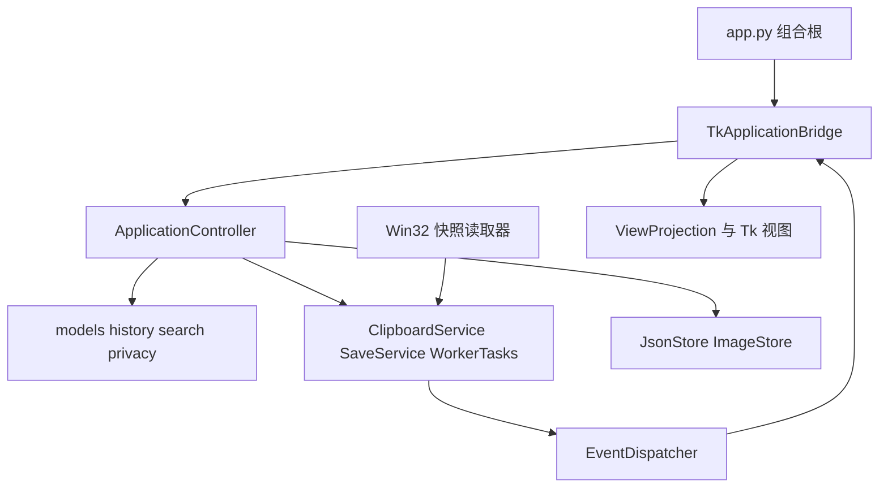

# 当前源码架构与维护约定

本文件描述服务重构后的源码，运行时仍为 Python 标准库、tkinter 与 ctypes/Win32，版本号保持 **2.6.1**，数据 schema 保持 3。源码重构与发行安装包是不同交付：没有因这次改动自动创建新 Release。

运行产品需要 Windows 和包含 Tcl/Tk 的 Python 3.10+；纯服务与合同测试可以在 Linux 执行。项目背景、性能诊断和视觉建议见 [PROJECT_REVIEW.md](PROJECT_REVIEW.md)。[架构设计.md](架构设计.md) 和 [上下文快照.md](上下文快照.md) 保留早期设计历史，不再作为当前文件清单。

## 模块边界

| 边界 | 模块 | 负责什么 |
|---|---|---|
| 配置 | `config.py`、`runtime.py` | 版本单一来源、默认值、路径、兼容运行状态 |
| 数据模型 | `models.py`、`history.py` | 校验归一化、旧 C 枚举兼容、入库/编辑、分类与敏感元数据更新 |
| 查询与显示 | `search.py`、`privacy.py`、`viewmodels.py` | 查询语法、按需拼音、有界缓存、统一遮罩、可见行惰性投影 |
| 纯处理 | `classify.py`、`tag.py`、`timefmt.py`、`image.py`、`exports.py`、`transform.py` | 内容规则、时间、编解码、导出和文本变换；不需要创建窗口 |
| 应用编排 | `application.py` | `ApplicationController` 持有历史、查询、任务和保存服务，提交后台采集结果与安排退出 |
| 调度与服务 | `dispatch.py`、`tasks.py`、`services.py` | 主线程结果队列、受限工作池、剪贴板序列确认、串行保存 |
| 文件适配器 | `storage.py`、`media.py` | 注入路径的 JSON / 图片文件读写；错误和损坏保护显式返回 |
| Windows 适配器 | `windows_api.py`、`windows_input.py`、`windows_focus.py`、`windows_geometry.py`、`windows_system.py`、`windows_effects.py`、`windows_hooks.py` | ABI 声明与各自系统能力；功能模块不反向导入兼容聚合入口 |
| 剪贴板适配器 | `clipboard.py`、`image_win32.py`、`win32_snapshot.py`、`hotkey.py` | 原生读写、一次快照、热键/托盘消息和剪贴板变化通知 |
| Tk 接线 | `tk_bridge.py`、`paste_adapter.py`、`data_adapter.py`、`system.py` | 把服务结果交给主窗口；数据、系统和粘贴的兼容入口 |
| 界面 | `app.py`、`app_ui.py`、`app_geometry.py`、`app_interact.py`、`widgets.py`、`vlist.py` | 布局、窗口几何和交互；列表复用可见行控件 |
| 业务弹窗 | `settings_dialog.py`、`transform_dialog.py`、`export_dialog.py` | 设置、异步变换与导出；完整数据不从截断预览控件取回 |
| 缩略图与数据资源 | `thumbnails.py`、`pinyin*.py` | 有界缩略图缓存、公共拼音聚合层与自动生成的数据分块 |



应用控制器和领域模块不导入 Tk 或 Win32。快照读取、时钟、路径、保存器和结果回调可注入，测试使用普通 Python 对象。`app*` 中仍保留旧窗口方法与 mixin 以兼容调用者；新增业务应优先放入独立服务，避免重新把完整用例塞回共享 `self`。

## 线程与生命周期

`EventDispatcher` 在创建线程记录 owner；只有该线程可以 `drain()`。工作线程可 `post()` 普通结果回调，不能调用 Tk，包括 `root.after()`、`winfo_*()`、`PhotoImage` 和控件读写。`TkApplicationBridge` 在主线程安排队列消费，再更新数据与界面。

`WorkerTasks` 默认最多两个工作线程、八个待处理任务，等待主线程交付的完成结果也计入容量。`submit()` 在满载或关闭时返回 `None`，关键操作的调用者必须安排重试。带 `key` 的任务支持代次控制，用于忽略过期搜索、预览或变换结果；它适合“只接受最新结果”的交互，不适合持久化。

保存使用独立 `SaveService`：单写入者串行处理，正在写入期间合并后续最新快照。调用 `request(data)` 取得容器快照后，worker 只读快照，不读取 App、Tk 或可变界面状态。`flush()` 等待最后接受的写入，失败会抛异常；保存失败不能视为成功退出。应用关闭时刷新数据、取消后续交互任务并关闭结果队列；过期结果不得在窗口销毁后更新 UI。

原生消息窗口使用 `AddClipboardFormatListener` 接收变化，消息线程只投递事件。启用通知时保留较低频轮询兜底；通知不可用时回退轮询。剪贴板采集、图片处理、保存、粘贴与预览各自通过对应服务控制顺序，不应额外启动不受限的“每个事件一个线程”。

## 数据和采集约定

- `JsonStore.load()` 只读取、归一化内存数据；旧 schema 的备份与迁移写回推迟到首次保存。未知顶层、设置和条目字段保留，旧 C 数字 `content_type` 归一化为字符串。
- 损坏 JSON 或非法根节点使仓库进入 `recovery_required` 只读保护。默认空数据允许显示 UI，但不能自动覆盖原文件；当前 UI 提醒恢复备份后重启，没有新增恢复向导。开发接口 `recover(data)` 只用于显式恢复，会先另存损坏原件。
- `JsonStore.save()` 使用唯一临时文件、flush/fsync 后 `os.replace()`；失败清理临时文件并保留原件。迁移备份保留 `.bak`、`.bak.1`、`.bak.2`。同步存储接口由后台单写入者调用。
- 图片文件名由 `ImageStore` 生成并检查，不能将任意路径当作条目图片名。删除历史引用后，图片清理要等待对应 JSON 快照保存成功；保存失败时不能先删掉仍被磁盘 JSON 引用的图片。
- `ClipboardService` 区分 `captured/retry/private/empty/unsupported` 等结果。临时占用或快照读取时内容变更应重试；处理成功或明确跳过后才确认序列。文本、文件、图片自写都必须同步自己的序列，避免自身内容重新入库。
- `HistoryService.replace_text()` 统一更新分类、大小、敏感信息和标签，使编辑后的搜索与显示一致；不要只改 `item['text']` 留下旧派生字段。
- 被动显示使用 `privacy.display_text()`。列表展示、复制提示与预览不能绕过设置显示原敏感正文；实际复制/粘贴与导出继续保留完整原文。显示截断不应成为真实数据截断。
- `runtime.NO_SAVE` 是测试写盘禁用源；构造 App 前还要把数据与日志目录指向临时目录。禁止把真实用户库作为会修改数据的测试 fixture；日志不能记录剪贴板正文或敏感标题。

C 版使用 `ClawBoardC/storage_compat.h` 保留共享 JSON 的未知值和稳定字段，`main.c` 负责原生适配。便携 C JSON 核心测试不能代替 MSVC 构建、Windows 字符转换和原生文件替换测试；两版的数据契约一致也不表示功能范围完全相同。

## 性能和兼容接口

搜索先处理元数据与直接正文命中，必要时才转换拼音，并用有界缓存复用。Tk 输入有短防抖；后台结果按查询、标签页、分组和数据修订号校验，旧结果不能用于粘贴或导出。`ViewProjection.project()` 创建轻量映射，正文分类、遮罩和副标题只在可见行读取时派生；原文保持完整。`VirtualList` 复用行池，并按稳定 ID 保留滚动锚点。

图片编解码与缩略图生成可独立测试；实际文件读取和转换通过后台任务执行，Tk 只接收结果并创建图像对象。缓存有容量边界，连续选择时旧预览结果应失效。文本变换保存完整结果模型，Text 控件可展示截断预览；复制、保存和覆盖必须读取结果模型。

旧导出由兼容层保留：

| 旧入口 | 当前实现 |
|---|---|
| `ClawBoard.py` / `import ClawBoard as C` | 主入口、公共符号重导出和 `NO_SAVE` 桥接 |
| `query.py` | `clawboard.search` |
| `clawboard.app_services` | `data_adapter` 与 `system` |
| `clawboard.dialogs` | 三个独立 `*_dialog` 模块 |
| `clawboard.win32` | `windows_*` 模块；保留替换点和可变 hook 状态的统一归属 |
| `clawboard.pinyin_data` / `pinyin_phrase` | 分块聚合，继续导出完整 `PINYIN` / `PINYIN_PHRASE` 字典 |

新增模块保持单个 `.py` 不超过 800 行。生成表维持原每行条目密度、按固定大小拆块；生成脚本清理陈旧数字分块，合同测试用固定有序内容 digest 检查每个键值及顺序。不要通过加长数据行规避文件规模限制。

合成性能对照使用开发工具 `tools/bench_refactor.py`，将 `--baseline` 指向未修改的上游 `6a10466` 源码：

```bash
python tools/bench_refactor.py --baseline /path/to/original --candidate . --output /tmp/performance-comparison.json
```

它测量查询、图片编解码和可见行投影的 CPU 工作。图片仅单次样本；这不代替 Windows 主线程延迟、滚动帧率、内存或长期运行测量。

## 回归与构建

从仓库根运行服务汇总入口：

```bash
python tests/_t44.py
```

它汇总 `test_*.py`。纯服务测试使用合成数据和临时目录；装配、Windows 声明与 UI 适配合同会使用模拟端口。Linux 跳过原生 Windows 导入兼容入口；C 共享数据测试在 POSIX 且有 gcc 时编译便携 JSON 核心，Windows 不运行这套依赖 POSIX UTF-8 locale 的驱动。通过/跳过数量以当次终端输出为准。

调试单个边界时可分别运行：

```bash
python tests/test_storage.py
python tests/test_services.py
python tests/test_application.py
python tests/test_search_service.py
python tests/test_viewmodels.py
python tests/test_image_codec.py
python tests/test_pinyin_data_contract.py
python tests/test_packaging_contract.py
```

Windows 桌面验证另行执行，先退出其他 ClawBoard 实例，并核对每个 GUI 脚本在导入应用前使用临时路径与 `NO_SAVE`：

```bash
python tests/test_refactor.py
python tests/_t35.py
python tests/_t37.py
python tests/_t42.py
python tests/_t43.py
```

还需按场景运行既有布局、缩放、图片和独立 QA 脚本。原生验证至少覆盖：文本/文件/图片剪贴板闭环、临时占用后重试、全屏置顶、浏览器与管理员窗口粘贴、双屏不同 DPI、热键/托盘、退出前保存失败后的重试。模拟合同不能证明 ctypes ABI、焦点、绘制或系统权限行为正确。

构建入口保持：

```bash
pyinstaller packaging/ClawBoard.spec --noconfirm
```

安装包由 `packaging/installer.iss` 读取 `dist/ClawBoard.exe`。新增运行时模块必须同步 spec 的 `hiddenimports`；图标作为资源随构建分发。静态打包合同检查通过后，仍需在 Windows 构建 exe 与安装包并做独立启动、保存和卸载烟测。版本号、发布说明和下载文件名只在明确发版时一起更新。
